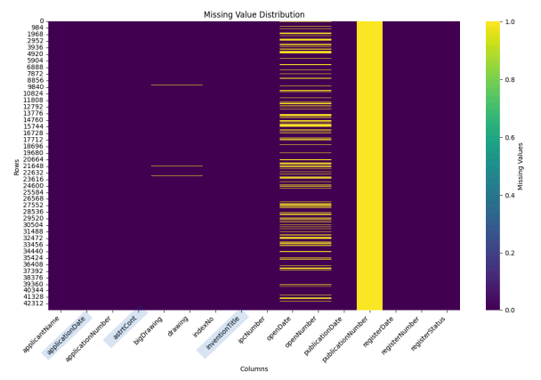

# Patent Data Processing Trends

- KIPRIS 특허 데이터를 활용한 디지털 데이터 처리 기술 트렌드 분석(LDA 토픽 모델링)

## Overview
- 특허 데이터는 전 세계 기술 정보의 90% 이상이 담겨 있는 국제 표준화된 정보 자원
- 본 프로젝트는 G06F(전기에 의한 디지털 데이터 처리) 분야 특허 **87,223건**을 수집·분석하여
  디지털 데이터 처리 기술의 주요 토픽과 트렌드를 파악
  
### Goal
  - 디지털 데이터 처리 분야의 주요 기술 토픽 파악
  - 토픽별 연도 변화 트렌드 파악

### Problem Definition
```
f: LDA 토픽 모델링
x: G06F 분야 특허 데이터 (KIPRIS, 2015~2024)
y: 디지털 데이터 처리 기술 트렌드
```

---

## Results

### EDA


### 토픽별 고빈도 단어 워드클라우드


### 토픽별 소속 특허 개수


### 토픽별 비율 연도 분포


### 토픽별 연도 분포 (개별 그래프)


### 토픽 클러스터링 & 네트워크 시각화


---

## Data

| 항목 | 내용 |
|------|------|
| 출처 | KIPRIS Plus Open API |
| 분야 | G06F (전기에 의한 디지털 데이터 처리) |
| 수집 기간 | 2015.01.01 ~ 2024.05.01 |
| 데이터 크기 | **87,223건** |
| 수집 항목 | 출원인, 출원일, 출원번호, 발명의 명칭, IPC 번호, 초록 등 |

---

## Pipeline


## Preprocessing

**1. 컬럼 정제**
- `applicationDate`, `astrtCont`, `inventionTitle` 컬럼만 유지, 나머지 제거
- 출원일 형식 변환: `yyyy-mm-dd` → `yyyy` (연도만 추출)

**2. 텍스트 클리닝**
- 한글·공백을 제외한 불필요한 문자 제거 (`clean_text()` 함수 적용)
- 특허 제목(title) + 초록(abstract) 대상

**3. 토큰화 & 품사 태깅**
- 라이브러리: `Okt` (KoNLPy)
- 명사(N), 동사(V), 형용사(A) 품사 토큰만 추출

**4. 불용어 처리**
- 고빈도 단어 분석 결과 기반 불용어 선정
- 도메인 특화 불용어 사전 추가 적용

---
 
## Model

**LDA (Latent Dirichlet Allocation)**
- 토픽 수별 성능 비교 후 **최적 토픽 수 10개** 선정

### 주요 결과

| 순위 | 토픽 | 트렌드 |
|------|------|------|
| 1 | 사용자 인터페이스 관련 기술 | 가장 높은 비중 |
| 2 | 사용자 인증 및 서비스 | 비중 **증가** 추세 |
| 3 | 터치스크린 및 센서 | 비중 감소 경향 |
| 4 | 메모리 및 저장장치 | 비중 감소 경향 |

### 토픽 그룹 분류
- **하드웨어 기술** : 디스플레이, 터치스크린, 메모리 등
- **소프트웨어 및 데이터 처리 기술** : 사용자 인터페이스, 데이터 분석 등
- **기반 기술** : 전력 제어, 네트워크 등

---

## 💡 Insight

- **기술 동향 파악 및 예측** : 연도별 토픽 비율 변화로 미래 유망 기술 예측 가능
- **국가 및 기업 경쟁력 제고** : 특허 분포 분석을 통한 기술 경쟁력 파악
- **신규 비즈니스 발굴** : 성장하는 토픽 기반 신규 사업 기회 식별

---

## Tech Stack

| Category | Stack |
|----------|-------|
| 토픽 모델링 | LDA (Gensim) |
| NLP | KoNLPy (Okt) |
| 데이터 처리 | pandas, numpy |
| 시각화 | matplotlib, wordcloud, NetworkX |
| 환경 | Google Colab, Python 3.10.12 |

---

## Project Structure
```
├── code/
│   ├── preprocessing/   # 전처리 코드
│   └── modeling/        # LDA 모델링 코드
├── data/
│   └── preprocessed data/
├── plot/
│   ├── eda/             # 탐색적 데이터 분석 시각화
│   └── modeling_visualization/  # 모델링 결과 시각화
└── README.md
```
